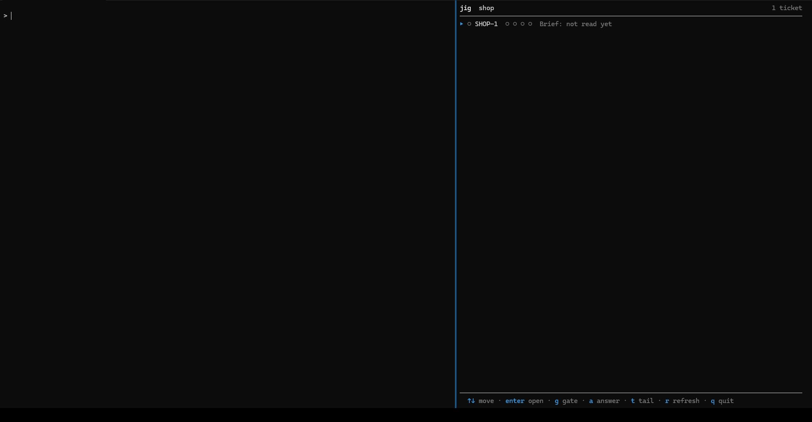

# jig

jig takes a ticket from brief to an evidence-backed pull request inside the
coding agent session you already run. It starts no session and picks no model:
your harness does the work with its own tools, subagents and model, and jig
listens through hooks, proves each commit with the slice's own test command, and
records the review and the publish.

[](https://github.com/develdeco/jig/actions/workflows/ci.yml)
[](https://github.com/develdeco/jig/releases/latest)
[](LICENSE)

## What working with jig looks like



On the left, Claude Code works on a small shop project; on the right, `jig tui`
follows the ticket, SHOP-1, from its brief to its pull request. The recording
runs at twice its speed, with the waits cut. The person started a Claude Code
session for each part (a fresh one for each review), typed six requests,
allowed three shell commands Claude Code asked about, and pressed five keys in
the TUI to act (`g` twice, `d`, `p`, `y`), besides refreshing it once and moving
between its screens. Everything else happened between the sessions and jig, and
the TUI shows the four steps in order, each with where it stands:

1. **Brief.** "Plan a ticket for this bug: cart.Total takes the discount off
   each line and truncates…". A Sonnet session drafts `brief.md` with the
   intake skill and shows it; on "Go with your recommendations" it writes
   `slices.yaml`, checks both with `jig validate --check`, and runs
   `jig validate`, which records the approval. The step goes from "being
   drafted" to "approved by … · 5 sections, 2 slices".
2. **Build.** "Build SHOP-1, and stop once its slices are green." The same
   session claims each slice and commits with a `Jig-Slice:` trailer. jig runs
   the slice's oracle on a detached copy of each commit and counts the slices
   green: green is what jig ran, never what the model said.
3. **Review.** The person presses `g` to open a round (a session can open one
   itself), and a fresh Opus session reviews the branch ("Review SHOP-1").
   Round 1 sends back a fix, a test that pins rounding half up, and asks one
   question; the person dismisses the question in the TUI with `d`. A new
   builder session makes the fix green, and round 2 comes back clean. jig
   checks each reviewer built none of what it reviewed.
4. **Publish.** `p`, then `y`: jig pushes the reviewed head and opens the pull
   request ([develdeco/jig-demo-shop#2](https://github.com/develdeco/jig-demo-shop/pull/2))
   with a body it writes from the brief, the slices and the review.

Enter opens a step's screen, and the recording visits each: the brief's sections
and the slices that cite them, the build's slices and sessions, each review round
with what it sent back and the ask it left, the pull request and how it got there.

## Getting started

No release carries this design yet (v0.1.x is the earlier one, which ran its own
builder sessions), so install from `main`, with Go 1.27.3 or newer:

```sh
go install github.com/develdeco/jig/cmd/jig@main
```

Once a release has it, the installers need no Go toolchain: they verify the
release checksum and install to a user directory.

```sh
curl -fsSL https://raw.githubusercontent.com/develdeco/jig/main/scripts/install.sh | sh
```

```powershell
irm https://raw.githubusercontent.com/develdeco/jig/main/scripts/install.ps1 | iex
```

Then, once per machine and once per repository:

```sh
jig setup --global --artifacts --yes   # skills, hooks, git's post-commit hook and a hint, for your agents
cd my-repo && jig init                 # this repo is a jig project: a jig.yaml here, a my-repo-tickets store beside it
```

From then on you talk to your agent, and keep `jig tui` open next to it. Each
prompt asks for one phase: the session checks that the ticket is at it, does it,
and stops with the prompt that asks for the next one.

| You ask your agent | What the session does | What jig does |
|---|---|---|
| "Plan a ticket for <what you want>" | drafts `brief.md` and `slices.yaml` with you (the `intake` skill), checking them with `jig validate --check`, and runs `jig validate` once you agree | checks the brief, the slices and the repo agree, and records your approval |
| "Build SHOP-1" | claims each ready slice, builds it, commits with a `Jig-Slice:` trailer | verifies every commit in the background and tells the session how it went |
| (the session is unsure) | asks with `jig ask` | parks the question; you answer from the TUI (`a`) or `jig answer` |
| "Review SHOP-1" | in a session that did none of the ticket's work, reads `jig review context`, records findings and closes the round; in the session that built it, spawns a subagent to do that, since a reviewer must not have built what it reviews | routes findings into fix slices, and checks the reviewer built none of the change |
| "Publish SHOP-1" | renders the body with `jig publish --body`, pushes and opens the PR, records it with `--pr` | or pushes and opens it itself with `jig publish` after your yes (the TUI's `p`) |
| "Take SHOP-1 from brief to PR" (or "Build and review SHOP-1") | an automatic run: does the phases in order, each with its skill, and stops at a refusal | answers each phase as above; `jig next SHOP-1` names the phase a ticket is at and the prompt that asks for the next |

Four moments need you: agreeing on the brief, answering a question a session
asked, deciding what a review asks, and approving the pull request. A prompt can
hand over the first and the last ("go with your recommendations" approves the
brief, "... to PR" or "and publish it" publishes), and what the session approves
for you is recorded as its own. Everything else is the session's work, proven by
jig.

**You need** `git` with an identity (jig authors every store commit as you) and a
harness. Claude Code is proven end to end; hook files for Codex, Gemini CLI,
Cursor, GitHub Copilot and OpenCode are written from their documentation.
[`gh`](https://cli.github.com/) is needed to open pull requests on GitHub.

## The TUI

`jig tui` is a view of everything in flight, built on the same stream
`jig events --follow` prints. A ticket is four steps taken in order (brief,
build, review, publish), each with its state in a few words: "approved by
<name> (person) · 5 sections, 3 slices", "1 of 3 green · verifying slice clamp
at bbbbbbb", "round 2 open · reviewer 2 (Claude Code · Opus 5) is reading the
change", "pull request opened · <url>". The steps are the same answer
`jig next` gives, so the screen and the command never disagree about where a
ticket stands. Under them is a list of the sub-steps of the one under the
cursor (each slice of the build, each review round with its asks and fixes, the
publish's body, approval, pull request and changelog, each with its state), and
under that its activity, told in words: a session by the role it plays (planner,
builder, reviewer, or reviewer subagent when the session that built the change
also reviewed it; a reviewer with its harness and model too), a slice by its
goal, a commit by its subject. Each activity line names the sub-step it
advances ("slice clamp", "round 1", "body"). Enter opens a step's screen, which
shows the records behind it: the brief's sections and the slices that cite them,
the build's slices with their workspace and oracle, their commits and every
oracle run (with the end of a failed one), each review round with its reviewer,
what it sent back and the asks it left, and the pull request's body and
changelog. `jig tui SHOP-1` can be open before SHOP-1 exists; it waits for the
ticket and fills in when it does.

From it you answer a session's question (`a`), keep or dismiss a review's ask
(`k`, `d`), open a review round (`g`), and approve and publish (`p`: after your
`y` it pushes the branch and opens the pull request). Every action it takes is a
jig command, recorded with your provenance.

## What jig tells your session

With the hooks installed, a directory in a jig project gets jig's voice at four
moments, and a directory in no project gets nothing:

- **Session start**: what `jig here` prints - the project, the ticket the branch
  names, its slices and their states, open questions, verifications still running,
  and the prompt that asks for the ticket's next phase.
  The harness's session id is set as `JIG_SESSION` for the session's shell
  commands where the harness allows it (Claude Code does), and asked of the
  agent where it does not.
- **A commit lands**: git's post-commit hook or the harness's PostToolUse hook
  starts `jig verify` for it, whichever sees it first.
- **The next shell command or prompt**: what the session has not heard yet, once - a
  verification's outcome, an answer to its question, a stall (the same failure
  twice), a brief edited under verified work, a commit outside every slice or one
  that names no slice, a stacked ticket's parent that moved on or merged, a ticket
  over its budget.
- **Stop**: a person at the keys is shown what is left. A session that claimed its
  slice with `--unattended` is held back once for each loose end - a verification
  still running, uncommitted files, a failed run, an approved publish not yet
  done, every slice green with no review opened.

The hooks always exit 0. `jig doctor` says whether a harness has ever called them,
and `<jig home>/logs/observe.log` has what went wrong.

## Setups

`jig setup` always names its scope: `--global` (you, on this machine), `--here`
(the project you are in; `jig attach` is the same) or `--project <name>`. The
pieces are `--skills`, `--hooks`, `--githook` and `--hint`, and `--artifacts` is
all four. `jig doctor` lists what is in place and what each missing piece costs,
and `--uninstall` takes away exactly what the same flags wrote.

| You are | Run | What you get |
|---|---|---|
| on your own machine in Claude Code | `jig setup --global --artifacts --yes`, then `jig init` in each repo | jig in your own configuration; each repo gets only a `jig.yaml` |
| in a repo that should carry nothing of jig but `jig.yaml` | `jig attach` | skill stub, hooks and hint in files git ignores (`.git/info/exclude`) |
| on a team repo that should carry jig | `jig attach --tracked` | committed skills, hooks and an `AGENTS.md` line; each teammate needs the jig binary |
| in several repos under one directory | `jig init` in that directory, `jig attach --members` | one project and one store over every nested repo; a ticket can build in several, with a slice naming its repo (`api/server`), a gate that reviews each and one pull request per repo, each linking the others |
| in another harness | `jig setup --global --hooks --harness codex,gemini --yes` (`all` for every one) | hook files for that harness |
| in a cloud session | `jig setup --cloud` | prints the environment setup script and writes nothing; the script installs the latest release, so it works once a release carries this design |
| in a harness with no hooks | `jig mcp` | the same commands as MCP tools over stdio |
| unattended | start the session yourself and claim with `--unattended` | refused claims and Stop for anything left undone |
| ready to share the project | `jig share` | sets the remotes and pushes the store and the repos |

A project is local until `jig share` publishes it, unless its store mirrors to
GitHub (below), which syncs from inside every command.

## The commands, for reference

The sessions run these for you; `jig <command> -h` prints any one's flags.

| Where | Commands |
|---|---|
| Set up | `setup`, `attach`, `doctor`, `init`, `repos`, `share`, `map`, `ignore` |
| Plan | `ticket new`, `graduate` (a chart's tickets), `recall`, `validate`, `brief show` (a brief and its illustration, served on 127.0.0.1), `rank` (the order to start ready tickets), `close` and `reopen` (a ticket closed without a pull request: covered, superseded or not planned) |
| Build | `here`, `next`, `claim`, `context`, `ask`, `answer`, `note`, `verify` |
| Review and publish | `gate`, `review context`, `finding`, `review done`, `triage`, `publish` |
| Watch | `status`, `events`, `tui`, `budget` |
| Plumbing | `observe` (the hook entry), `mcp`, `store`, `trackers sync`, `requeue` |

A branch you built without a brief can still go through review: mint a ticket
and run `jig gate <ticket> --branch <name>`; the ticket adopts the branch.

## Working with several people

A store is a git repo everyone pushes to. `jig store migrate --writers` gives
each clone a branch of its own and keeps the facts only one person may hold - a
minted id, a ticket's driver - on an append-only claims branch; `jig status`
names who drives a ticket. Every store commit carries the identity git resolves
in your clone. `jig share` sets up the remotes when you are ready.

## GitHub mirror

jig can mirror the store onto GitHub issues and a GitHub Project from inside
every command. Add to the store's `store.yaml`:

```yaml
trackers:
  - github:
      repo: your-org/your-tracking-repo
      project: https://github.com/orgs/your-org/projects/7
```

A project of a personal account is `https://github.com/users/<login>/projects/<n>`.
Issues live in `repo:`; jig creates the project's `Status` and `Store ID` fields
on its first sync. The `gh` token needs the `project` scope. A `publish-terms.txt`
in the jig home names terms that must never reach a public issue. Edits made on
GitHub to fields jig owns are reported as drift and overwritten;
`jig trackers sync --dry-run` shows what a sync would change. What jig knows of
each issue is kept in the store's `trackers/` tree, one record and one link to
the ticket per issue, and a ticket closed with `jig close` has its issue closed.

Stores made by an older jig are upgraded with `jig store migrate`; its `-h`
explains each step.

## Safety

jig starts no coding session. On your machine it runs `git`, `gh`, your repo's
own oracle commands (in a detached worktree of the commit, bounded by the
manifest's `timeout:`, 30 minutes by default), `graphify` when the store's
`store.yaml` names it under `context:` and it is on your PATH, and itself. It edits your settings
and memory files only after a yes, keeps everything in them that is not its
own, and its uninstall takes out only what it wrote. The machine ledger, under
the jig home, records for sessions in jig projects the first 400 bytes of each
command and the files touched. With git's global hook installed (`--githook`,
part of `--artifacts`) it also records every commit made on the machine, in any
repository: its hash, branch and directory. The ledger never enters the store.

`jig share` is the one verb that commits to your repository: after your yes it
commits `jig.yaml` on the branch you have checked out and pushes it. Otherwise
the ticket branch is pushed only by `jig publish` after your confirmation, or by
your own session, and jig makes no commit on it.

A review round with no brief and no stated intent reads the local Claude Code
transcripts of the sessions that worked the ticket (the ones jig's machine ledger
names, else a search of your transcripts by the files the change touched), and
hands the reviewer an excerpt of the best match's text (no tool calls); state the
intent with a brief, `--intent` or `--doc` when a session's text must not reach a
reviewer. `jig brief show` listens on 127.0.0.1 only, and answers only requests
that name a local host. See
[ARCHITECTURE.md](ARCHITECTURE.md#safety) and
[.github/SECURITY.md](.github/SECURITY.md).

## Docs

- [CONTEXT.md](CONTEXT.md) - the vocabulary jig's code and docs share.
- [ARCHITECTURE.md](ARCHITECTURE.md) - the pipeline, store schema, modules and
  the safety model in full.
- [docs/adr/](docs/adr/) - why each structural decision was made;
  [ADR 0032](docs/adr/0032-jig-attaches-to-the-harness.md) is the one behind
  this design, and [ADR 0033](docs/adr/0033-phases-are-asked-for-by-prompt.md)
  the one behind asking for a phase by prompt.
- [DECISIONS.md](DECISIONS.md) - the build log.
- [.github/CONTRIBUTING.md](.github/CONTRIBUTING.md) - how to build, test and
  change jig.
- [skills/](skills/) - the session skills embedded in the binary.

## Roadmap

Not built yet: `jig watch`, cloud sessions and Remote Control beyond the
printed setup script, and a live check of any harness but Claude Code. Further out: Jira and Linear
mirrors and nix packaging.
