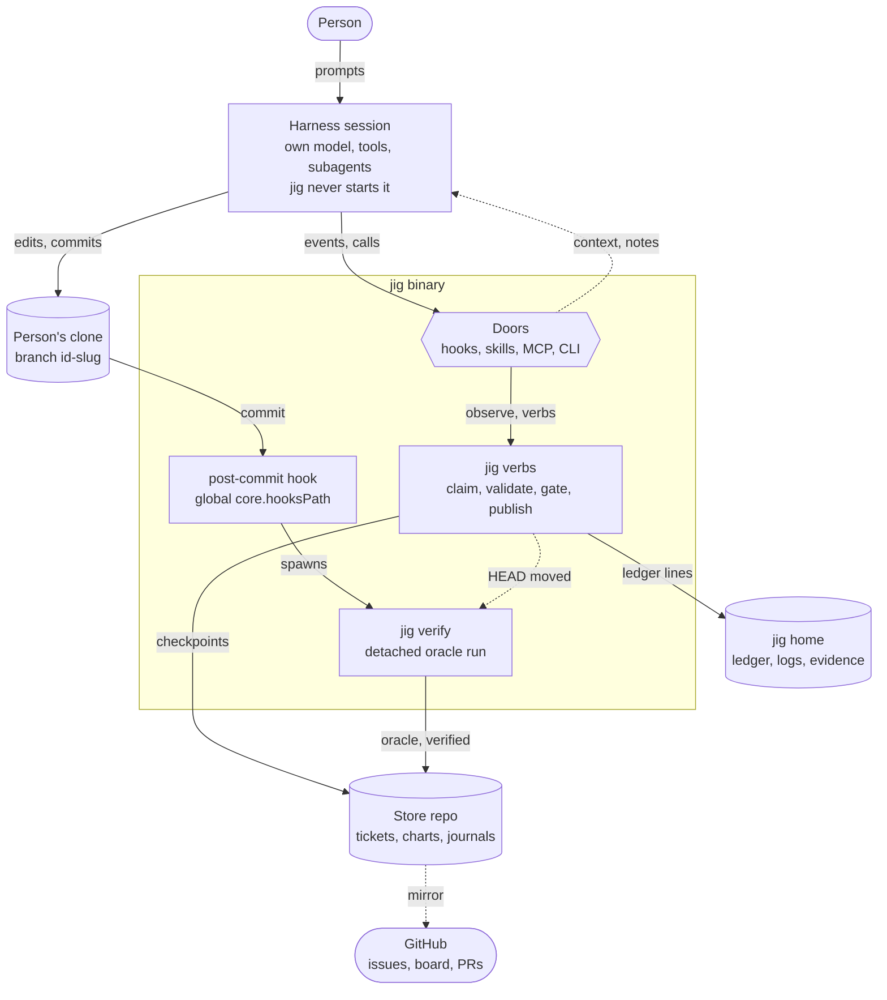
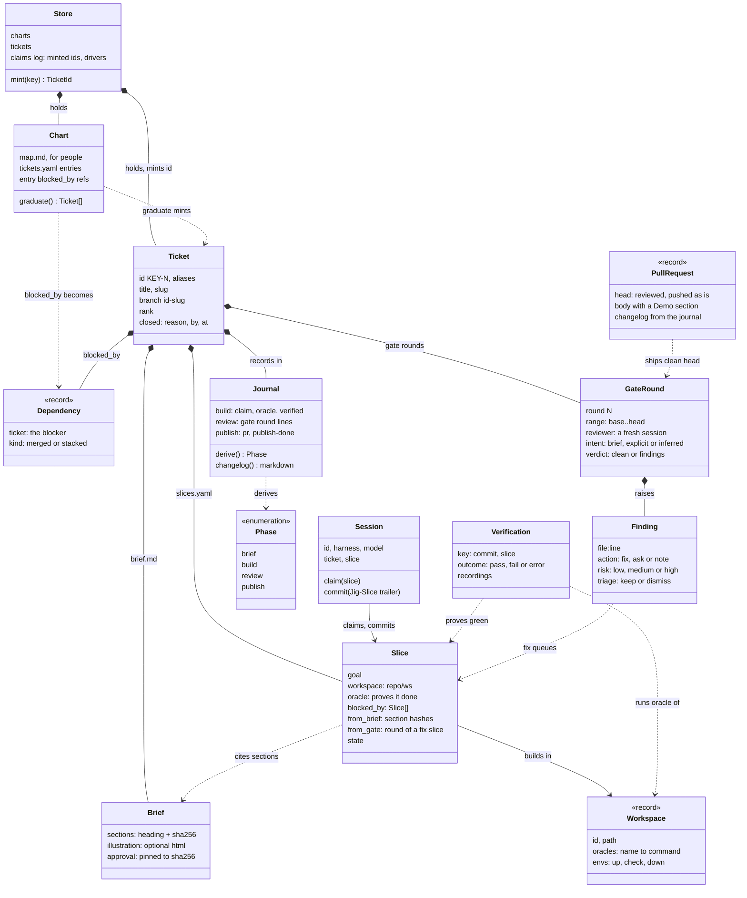
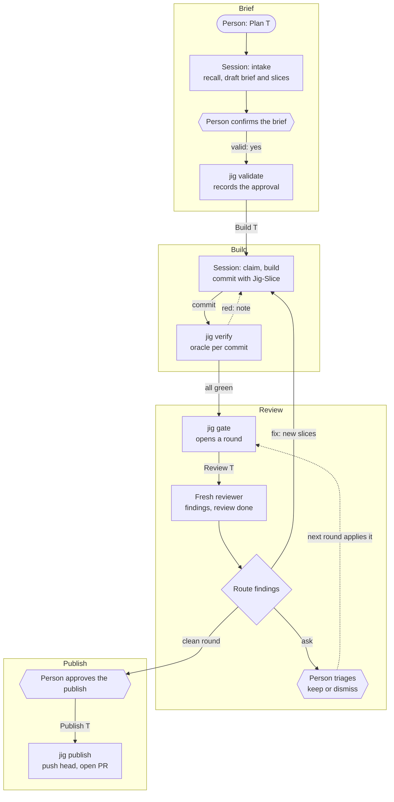
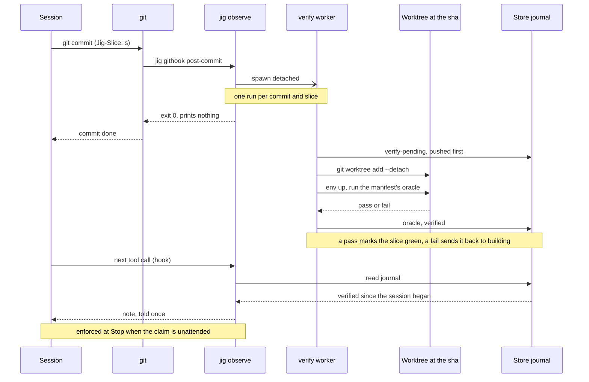
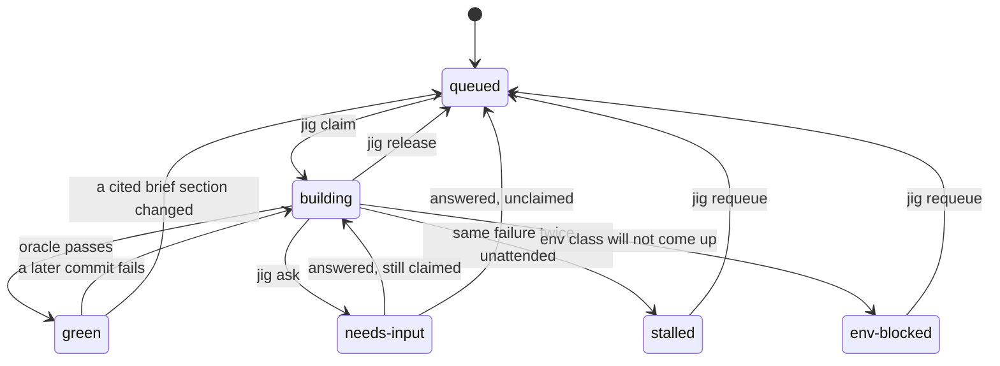

# Diagrams

Five pictures of jig, for people who want the shape before the prose.
[CONTEXT.md](../CONTEXT.md) and [ARCHITECTURE.md](../ARCHITECTURE.md) stay
the authority: when a diagram and the prose disagree, the prose is right and
the diagram is stale. Each diagram was drawn from the code at `cc02c78`.

Each also has an [interactive version](https://develdeco.github.io/jig/)
where every element links to the code it was drawn from. The Mermaid here is
the one kept in step with the code; the interactive pages are redrawn from
their sources on the `gh-pages` branch when they drift.

- [System context](#system-context): what jig attaches to and where its state lives
- [Domain model](#domain-model): how charts, tickets, briefs, slices and rounds relate
- [A ticket from brief to PR](#a-ticket-from-brief-to-pr): the four phases and who acts in each
- [A commit's verification](#a-commits-verification): from `git commit` to the note the session hears
- [A slice's states](#a-slices-states): what moves a slice between queued and green

## System context

jig is one binary reached through four doors. It never starts the harness
session; it observes it, verifies its commits in a detached worker, and
keeps the facts in the store and the jig home.
[Interactive version](https://develdeco.github.io/jig/diagrams/system-context.html).

## Domain model

A chart graduates into tickets. A ticket holds its brief, its slices, its
journal and its gate rounds. A slice cites the brief sections it comes from,
and a fix finding from review becomes a new slice.
[Interactive version](https://develdeco.github.io/jig/diagrams/domain-model.html).

## A ticket from brief to PR

Each phase starts from a prompt ("Plan T", "Build T", "Review T",
"Publish T"); a prompt that names several runs them in order. Confirming the
brief and approving the publish stay the person's unless the prompt
delegates them. Review has no back-edges: a fix finding becomes new work.
[Interactive version](https://develdeco.github.io/jig/diagrams/ticket-flow.html).

## A commit's verification

A commit that names a slice is verified in the background, in a detached
worktree at that commit. The session is told the outcome once, at its next
tool call or prompt. The worker shares no memory with the session: the store
and the machine ledger are the whole interface.
[Interactive version](https://develdeco.github.io/jig/diagrams/commit-verification.html).

## A slice's states

A slice is ready when it is queued and every slice it is blocked by is
green; `jig next` lists those. Only a verification makes a slice green.
[Interactive version](https://develdeco.github.io/jig/diagrams/slice-states.html).

A claim of a stalled or env-blocked slice also moves it to building.
